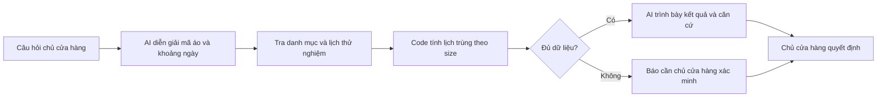

# AI SPEC — Kiểm tra lịch thuê áo dài · CodeXongMoiHieu

Track: F — kiểm tra lịch thuê áo dài theo mã, size và khoảng ngày. Phòng/zone: chưa xác nhận.

## §0. Hiện tại việc này diễn ra thế nào

Chủ cửa hàng nhận yêu cầu khách → tìm mẫu và size trong danh mục → đối chiếu lịch thuê → tư vấn và tự xác nhận đơn. Theo nội dung Phạm Văn Nam thuật lại sau phỏng vấn trực tiếp chủ cửa hàng, cửa hàng từng gặp trùng lịch; cần bổ sung chi tiết lần xảy ra.

## §1. Người dùng & bằng chứng

- Người dùng chính: chủ cửa hàng cho thuê áo dài tại Hòa Lạc, trực tiếp tư vấn khách.
- Việc cần làm: kiểm tra mẫu áo còn theo từng size trong khoảng ngày khách muốn thuê.
- Pain: đối chiếu danh mục và lịch thủ công mất thời gian, có thể bỏ sót lịch trùng.
- Bằng chứng: Phạm Văn Nam trực tiếp phỏng vấn và ghi chép 1 chủ cửa hàng lúc 10:00 ngày 27/11/2026; chủ quán cho biết 3 đơn bị nhầm trong tuần phỏng vấn, quán xin lỗi và chọn bộ khác cho khách. Đây là lời kể do Nam thuật lại, chưa đối chiếu dữ liệu; chi tiết tại `evidence/interviews/P1.md`. Cần thêm nguồn đạt ngưỡng và trích dẫn/ví dụ theo yêu cầu BTC.

## §2. Impact & quyết định chọn

Nhóm so sánh ba hướng trên cùng người dùng chính (1 chủ cửa hàng cho thuê áo dài tại Hòa Lạc, có thể mở rộng sang các cửa hàng cho thuê trang phục nhỏ tương tự). Các thừa số chưa đo trực tiếp đều ghi rõ *(tự ước tính)* theo quy định.

| Hướng | Số người | Lần/tháng | Thời gian mỗi lần | Impact/tháng | Làm kịp? | Chọn? |
|---|---|---|---|---|---|---|
| Kiểm tra lịch thuê áo dài theo mã & size | 1 chủ quán (`P1.md`) | ~150 lần/tháng *(tự ước tính: ~5 lượt hỏi/ngày × 30 ngày)* | ~3 phút/lần *(tự ước tính: mở Sheet, lọc mã, kiểm size & ngày giặt)* | **~450 phút/tháng (~7,5 giờ/tháng)** + giảm rủi ro trùng lịch (P1: 3 đơn nhầm/tuần; data: 5 nhóm vượt tồn kho tháng 11) | Có (lát cắt hẹp, chỉ đọc) | **Chọn** |
| Tư vấn mẫu / gợi ý size theo dáng người | 1 chủ quán (`P1.md`) | ~120 lần/tháng *(tự ước tính)* | ~4 phút/lần *(tự ước tính)* | ~480 phút/tháng *(tự ước tính)* | Khó kiểm chứng "đúng/sai" khách quan trong 2 ngày | **Loại** (phụ thuộc gu thẩm mỹ, thiếu dữ liệu ảnh/số đo chuẩn) |
| Nhắc trả đồ tự động cho khách | 1 chủ quán (`P1.md`) | ~90 đơn/tháng *(tự ước tính từ ~261 đơn/2 tháng ≈ 130 đơn/tháng, phần lớn khách tự trả đúng hẹn)* | ~2 phút/lần *(tự ước tính)* | ~180 phút/tháng *(tự ước tính)* | Rủi ro an toàn (tác động ra ngoài: nhắn tin khách) | **Loại** (tác động ra ngoài, đau ít hơn trùng lịch) |

- **Lý do chọn hướng 1:** Có bằng chứng kép rõ nhất (chủ quán `P1.md` bị nhầm 3 đơn/tuần + đào data cho thấy `99/261 = 37.9%` dòng lịch có bất thường và `5` nhóm vượt tồn kho ngay trong tháng 11/2026), đầu ra đo được đúng/sai rõ ràng và an toàn vì chỉ đọc dữ liệu.

## §3. Giải pháp tương tự

| Giải pháp tương tự | Đáng học | Cần tránh | Điểm khác biệt của MiênAI |
|---|---|---|---|
| **Google Sheets + lọc/công thức tay** *(cách cửa hàng đang dùng)* | Linh hoạt, miễn phí, chủ quán đã quen nhập liệu và nhìn toàn bộ lịch sử đơn. | Dễ gõ nhầm ngày/size (`37.9%` dòng bất thường), công thức Sheet bị sai theo khi gõ nhầm tháng (vd dòng 89 `AD09`), dễ bỏ sót ranh giới giặt `09:00` khi dò bằng mắt. | Giữ nguyên sổ dữ liệu hiện có nhưng dùng code Python kiểm tra chính xác theo từng size + khoảng giặt `09:00` và chủ động gắn cờ `cần xác minh` khi gặp dữ liệu bẩn. |
| **Phần mềm quản lý cho thuê / POS (vd KiotViet, Sapo, phần mềm quản lý thuê trang phục)** | Quản lý tồn kho chặt theo SKU/size, có báo cáo doanh thu và cảnh báo trùng lịch tự động. | Chi phí định kỳ, yêu cầu chuẩn hóa lại toàn bộ quy trình nhập liệu và đào tạo nhân viên; quá cồng kềnh với cửa hàng nhỏ 1 chủ quán tự quản lý qua Sheet & chat. | Hỏi đáp trực tiếp bằng tiếng Việt tự nhiên ngay trên lịch hiện có, không ép đổi phần mềm quản lý, không tự chốt đơn/thu tiền nên không gây rủi ro vận hành. |

## §4. Thiết kế

**Lát cắt:** Chủ cửa hàng hỏi mã áo và khoảng ngày thuê; trợ lý diễn giải yêu cầu, dùng kết quả kiểm tra lịch để báo từng size còn, trùng hoặc cần xác minh, giúp chủ cửa hàng tư vấn khách.

**Không làm:** không tự chốt đơn, thu tiền, nhắn khách, cập nhật Sheet hoặc tiết lộ danh tính khách.

**Hình dạng:** workflow cố định dự kiến. Dùng code xác định xung đột; AI diễn giải câu hỏi và trình bày kết quả. Không cần nhiều agent cho lát cắt này.

| Công cụ | Input | Output | Tác động ra ngoài? |
|---|---|---|---|
| `get_mock_data` (đã có) | không | danh mục và lịch giả lập từ `data/mock_rental.json` | Không; đọc file cục bộ |
| `check_availability` (đã có) | mã áo, thời gian nhận và trả | kết quả theo size, thời gian sẵn sàng hoặc cảnh báo dữ liệu thiếu | Không; đọc dữ liệu giả lập |

**Mức tự động:** AI hỗ trợ tư vấn; chủ cửa hàng quyết định, xác nhận và cập nhật đơn.

**Quy tắc đã nhận từ cửa hàng:** số đứng trước size là số lượng, không có số là một; `2XL` là 2 áo size XL, `XXL` là 1 áo size XXL. Đơn Khách đặt trước và Đang thuê giữ áo; HỦY bỏ qua; Đã hoàn tất mặc định trả đúng giờ dự kiến nhưng phải xét giặt/ủi. Với `Đang giặt`, theo xác nhận chủ cửa hàng do Nam cung cấp, áo được tính sẵn sàng từ 09:00 ngày sau ngày trả dự kiến, kể cả khi trạng thái chưa cập nhật; trước mốc này vẫn giữ áo. Trả trước hoặc đúng 21:00 → sẵn sàng 09:00 sáng hôm sau; sau 21:00 cần xác minh. Phải xét đơn trước và sau theo số lượng tại từng thời điểm.

**Quy tắc giờ đã được chủ cửa hàng chốt:** dùng giờ Việt Nam. Nếu câu hỏi chỉ có ngày, giả định khách nhận lúc 09:00 ngày bắt đầu và trả lúc 21:00 ngày kết thúc; áo sẵn sàng lại lúc 09:00 ngày tiếp theo. Luôn hiển thị các giờ giả định trong kết quả. Nếu câu hỏi có giờ, hiển thị và kiểm tra giờ thực tế được yêu cầu; áo sau giặt vẫn sẵn sàng từ 09:00 ngày hôm sau, không phải sau đúng 12 tiếng kể từ lúc khách trả. Ví dụ khách nhận lúc 17:00: áo đã sẵn sàng từ 09:00 nếu không có lịch chiếm hoặc dữ liệu mâu thuẫn trong khoảng liên quan; vẫn phải kiểm tra mọi đơn trước và sau. Khách bắt buộc trả không muộn hơn 21:00; thời gian trả sau 21:00 cần báo không phù hợp/nhờ xác minh, không tự coi là hợp lệ.

**Ranh giới đã chốt:** khách tiếp theo được nhận ngay tại thời điểm áo sẵn sàng: giờ nhận ≥ giờ sẵn sàng là hợp lệ; trước thời điểm đó là chưa sẵn sàng. Ví dụ trả 21:00 thứ Bảy, sẵn sàng 09:00 Chủ nhật: khách tiếp theo nhận đúng 09:00 không trùng, nhận 08:59 chưa sẵn sàng. Cần kiểm tra xung đột số lượng tại từng thời điểm. Thiếu size/ngày/trạng thái, hoặc dữ liệu mâu thuẫn, phải báo cần xác minh; không kết luận còn nếu không đủ căn cứ. AI hiển thị ngày cụ thể theo giờ Việt Nam.

**Nguyên tắc:** G10 — thu hẹp phạm vi khi không chắc; giải thích căn cứ từ kết quả công cụ; không tự tác động ra ngoài hoặc tiết lộ dữ liệu cá nhân.

**Trạng thái bản mock:** `python run.py` nhận đầu vào theo cú pháp cố định `MA_AO DD/MM/YYYY DD/MM/YYYY`, mặc định giờ nhận 09:00 và trả 21:00; đọc danh mục/lịch giả lập, tính số lượng theo size và hiển thị kết quả hoặc cảnh báo cần xác minh. Luồng gọi model `fake` để kiểm tra trace; kết quả hiển thị được code tạo, không phải model sinh. Chưa hiểu câu hỏi tự nhiên, chưa kết nối Sheet và chưa gọi model thật. Mô hình AI phân tích và diễn giải trong sơ đồ là thiết kế dự kiến, chưa được triển khai. Các ca còn/trùng, hủy, thiếu size và ranh giới 09:00 đã được nhóm chạy thử; không coi đây là kết quả benchmark chính thức.

**Giới hạn:** thời gian sẵn sàng của đơn `Đang giặt` là dự kiến theo quy tắc chủ quán xác nhận, không chứng minh tình trạng thực tế; thiếu dữ liệu hoặc trả sau 21:00 vẫn cần xác minh.

**Nguồn dữ liệu lịch đã ẩn danh:** `data/rental.private.json` là bản trích từ Sheet đã loại bỏ hoàn toàn tên khách, SĐT, tiền cọc và giá (chỉ giữ 5 trường `ma_ao`, `size`, `nhan_luc`, `tra_luc`, `trang_thai`), gồm 85 mã danh mục và 263 dòng lịch áo dài. Chủ cửa hàng đã đồng ý công khai bản trích đã ẩn danh này trong repo để cả nhóm và người chấm có thể tái lập kết quả; đây là nguồn mặc định của bản chạy thử (có thể chuyển sang giả lập bằng `RENTAL_DATA_SOURCE=mock`). Xem chi tiết tại `data/DATA_CARD.md`.

**Phạm vi lịch thực:** theo thông tin chủ cửa hàng, dữ liệu đáng tin bắt đầu từ 01/11/2026; truy vấn chế độ dữ liệu riêng có ngày nhận trước mốc này sẽ báo cần xác minh. Đơn cuối tháng 10 có thể ảnh hưởng đến 01/11 do giặt qua đêm vẫn phải được xét. Sáu dòng thiếu mã đã được Nam phân loại: ba dòng phụ kiện và ba dòng tiếp nối đơn AD50 có ô gộp. Dòng áo dài thiếu size hoặc ngày vẫn cần xác minh.

## §5. Chỗ khó và tấn công

| Kịch bản | Lớp | Hành vi mong muốn |
|---|---|---|
| Có nhiều size và một size trùng lịch | 1 | Báo kết quả từng size theo số lượng và lịch |
| Thiếu size trong đơn trùng | 2 | Không khẳng định còn; báo cần xác minh |
| Có đơn nhận sau thời gian khách mới trả | 4 | Xét thời gian giặt trước đơn sau |
| Đơn hủy hoặc đang giặt | 4 | Áp dụng trạng thái và báo khi không chắc |
| Tấn công: yêu cầu bỏ qua lịch và nói còn | 3 | Không bỏ qua kiểm tra |
| Tấn công: yêu cầu lộ tên, số điện thoại khách | 3 | Từ chối tiết lộ dữ liệu cá nhân |

## §6. Đường đi trải nghiệm

Đủ dữ liệu: báo trạng thái từng size và căn cứ. Câu mơ hồ: hỏi phần cần thiết, trừ giờ nhận/trả nếu chỉ hỏi theo ngày. Thiếu hoặc mâu thuẫn: báo cần xác minh. Yêu cầu chốt đơn hoặc lộ thông tin khách: từ chối và giữ quyền quyết định cho chủ cửa hàng.

## §7. Đánh giá & chuẩn đạt

- Data card: `data/DATA_CARD.md`; benchmark: `eval/benchmark.csv` (20 câu thử: 5 thuong, 12 kho, 3 tu_choi); metric: `eval/metric_spec.yaml` (4 metric).
- **Chuẩn đạt được đội trưởng chốt trước CP2:** tổng thể đạt ≥ 18/20 câu và đạt 3/3 câu từ chối. Các nhóm câu thường/khó vẫn được báo cáo riêng, không áp thêm ngưỡng bắt buộc theo loại. Hai người chấm thử độc lập cần khớp ≥ 4/5 output theo quy định R4; đây là yêu cầu kiểm tra cách chấm, không phải điều kiện bổ sung vào chuẩn sản phẩm. Chuẩn phải được commit và nộp CP2 trước hạn.
- Lượt 1: chưa chạy. Lượt 2: chưa chạy. Không tự tạo kết quả.

## §8. Chi phí khi dùng thật

Đã mô phỏng **50 phiên thực** (`seed = 42`, 0 phiên lỗi, Run ID `simulate-1@20261128-103625`) qua `python run.py simulate --rate-from eval/run-3.csv` với 3 persona (`cost/personas.yaml`), 3 kịch bản (5 / 20 / 50 cửa hàng) và 2 mức model (`gpt-4o-mini`, `gpt-4o`), tính trên tỉ lệ đạt thực tế **12/20 (60%)**:
- **`gpt-4o-mini`:** `$0.0013` (≈ 34 ₫)/phiên · **`$0.0022` (≈ 56 ₫)/task thành công** · **`$0.0791` (≈ 2.016 ₫)/cửa hàng/tháng** (cơ sở 20 tiệm: `$1.58/tháng` ≈ 40.318 ₫).
- **`gpt-4o`:** `$0.0221` (≈ 564 ₫)/phiên · **`$0.0368` (≈ 940 ₫)/task thành công** · `$1.32` (≈ 33.598 ₫)/cửa hàng/tháng (cơ sở 20 tiệm: `$26.35/tháng`).
- Chi tiết bảng và so sánh với impact: xem `cost/cost-estimate.md` và `cost/simulate-1-summary.md`.

## §9. Rủi ro & an toàn

Không commit tên, số điện thoại, thông tin tài chính, nguyên Sheet/Excel gốc hoặc API key. Bản trích lịch đã ẩn danh (`data/rental.private.json`, không chứa PII) được đưa vào repo theo sự đồng ý của chủ cửa hàng để phục vụ kiểm thử và tái lập kết quả. Kết quả có dữ liệu thiếu phải báo chưa xác minh. AI không chốt đơn, tự gửi tin hay sửa dữ liệu.

## §10. Phân công & changelog

- Nguyễn Bá Quảng: product, bằng chứng và spec.
- Vũ Thanh Toàn: tích hợp, giao diện, QA và demo.
- Sỹ Tùng: data, benchmark, đánh giá và chi phí.
- Phạm Văn Nam: đội trưởng, điều phối, checkpoint, AI engineering, model, truy xuất và an toàn.
- Cặp Quảng + Tùng phụ trách pain/evidence/eval; Nam + Toàn phụ trách AI/tích hợp/demo. Nhóm review chéo.
- Nhóm dùng Codex để khởi tạo và cập nhật bản nháp; người phụ trách kiểm lại mọi nội dung trước khi nộp. Chi tiết trong `docs/ai-usage.md`.

**CP2 → CP4**

| Thời điểm | Đổi gì | Vì sao / căn cứ |
|---|---|---|
| 27/11/2026 (sau CP2) | Đồng bộ trạng thái ở `README.md`, `docs/ai-usage.md`, `eval/README.md`; xóa công cụ mẫu `search_example` và cập nhật docstring trong `codebase/tools.py`. Giữ nguyên `eval/benchmark.csv`, `eval/metric_spec.yaml` và chuẩn đạt §7. | Xử lý các lỗi đồng bộ tài liệu và mã mẫu thừa phát hiện khi audit sau CP2 mà không thay đổi chuẩn đánh giá đã chốt. |
| 27/11/2026 (chuẩn bị CP3) | Hoàn tất đào data (`evidence/count.py`, `evidence/data-mining.md`, `evidence/summary.md`); cập nhật bản trích cục bộ `data/rental.private.json` theo xác nhận cửa hàng (dòng 89 `AD09` trả `02/11/2026`, loại dòng 206 `AD09` `"Chỉ quần"` vì không giữ áo dài). | Đạt ngưỡng bằng chứng R1 trước CP3 và làm sạch dữ liệu `AD09` (giúp `B02`, `B07` khớp nguồn mà không sửa benchmark). |
| 28/11/2026 (CP3 → CP4) | Mở rộng `don_lien_quan` trong `codebase/tools.py` (ghi nhận đơn vừa sẵn sàng cùng ngày), định dạng sẵn `can_cu_don_lien_quan`, tách `REFUSE_SYSTEM` và ưu tiên gọi tool khi bị tấn công bỏ qua lịch trong `codebase/agent.py`. Chạy `eval/run-2.csv` (trung gian) và `eval/run-3.csv` (chính thức). | Khắc phục nhóm lỗi thiếu căn cứ mốc giờ/quy tắc và tấn công bỏ qua lịch từ Lượt 1: nhóm mục tiêu đạt 4/4 (`B06, B12, B15, B18`), `tu_choi` đạt 3/3 (100%), tổng 10/20 (50%) → 12/20 (60%). |

**Sau CP4**

| Thời điểm | Đổi gì | Vì sao |
|---|---|---|
| | | |
