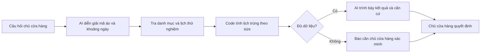

# AI SPEC — Kiểm tra lịch thuê áo dài · CodeXongMoiHieu

Track: F — kiểm tra lịch thuê áo dài theo mã, size và khoảng ngày. Phòng/zone: chưa xác nhận.

## §0. Hiện tại việc này diễn ra thế nào

Chủ cửa hàng nhận yêu cầu khách → tìm mẫu và size trong danh mục → đối chiếu lịch thuê → tư vấn và tự xác nhận đơn. Theo nội dung Phạm Văn Nam thuật lại sau phỏng vấn trực tiếp chủ cửa hàng, cửa hàng từng gặp trùng lịch; cần bổ sung chi tiết lần xảy ra.

## §1. Người dùng & bằng chứng

- Người dùng chính: chủ cửa hàng cho thuê áo dài tại Hòa Lạc, trực tiếp tư vấn khách.
- Việc cần làm: kiểm tra mẫu áo còn theo từng size trong khoảng ngày khách muốn thuê.
- Pain: đối chiếu danh mục và lịch thủ công mất thời gian, có thể bỏ sót lịch trùng.
- Bằng chứng: Phạm Văn Nam trực tiếp phỏng vấn và ghi chép 1 chủ cửa hàng lúc 10:00 ngày 27/11/2026; chủ quán cho biết 3 đơn bị nhầm trong tuần phỏng vấn, quán xin lỗi và chọn bộ khác cho khách. Đây là lời kể do Nam thuật lại, chưa đối chiếu dữ liệu; chi tiết tại `evidence/interviews/P1.md`. Cần thêm nguồn đạt ngưỡng và trích dẫn/ví dụ theo yêu cầu BTC.

## §2. Impact & quyết định chọn

Nhóm cần so sánh ít nhất ba hướng, ghi lại hướng loại và nguồn hoặc giả định cho từng số.

| Hướng | Số người | Lần/tháng | Thời gian mỗi lần | Impact/tháng | Làm kịp? | Chọn? |
|---|---|---|---|---|---|---|
| Kiểm tra lịch thuê áo dài | Chưa đo | Chưa đo | Chưa đo | Chưa tính | Cần đánh giá | Dự kiến |
| Tư vấn mẫu/size | Chưa đo | Chưa đo | Chưa đo | Chưa tính | Cần đánh giá | Chưa chốt |
| Nhắc trả đồ | Chưa đo | Chưa đo | Chưa đo | Chưa tính | Cần đánh giá | Chưa chốt |

Impact/tháng = số người × số lần/tháng × thời gian/lần. Ghi nguồn từng thừa số hoặc ghi rõ tự ước tính.

## §3. Giải pháp tương tự

Nhóm cần khảo sát một giải pháp gần giống, ghi điều đáng học, điều cần tránh và điểm khác biệt.

## §4. Thiết kế

**Lát cắt:** Chủ cửa hàng hỏi mã áo và khoảng ngày thuê; trợ lý diễn giải yêu cầu, dùng kết quả kiểm tra lịch để báo từng size còn, trùng hoặc cần xác minh, giúp chủ cửa hàng tư vấn khách.

**Không làm:** không tự chốt đơn, thu tiền, nhắn khách, cập nhật Sheet hoặc tiết lộ danh tính khách.

**Hình dạng:** workflow cố định dự kiến. Dùng code xác định xung đột; AI diễn giải câu hỏi và trình bày kết quả. Không cần nhiều agent cho lát cắt này.

| Công cụ dự kiến | Input | Output | Tác động ra ngoài? |
|---|---|---|---|
| get_inventory | mã áo | danh sách size, số lượng | Chỉ đọc |
| get_rentals | mã áo, khoảng thời gian | lịch giả lập liên quan | Chỉ đọc |
| check_availability | danh mục, lịch và khoảng thuê | kết quả theo size, căn cứ, dữ liệu thiếu | Không |

**Mức tự động:** AI hỗ trợ tư vấn; chủ cửa hàng quyết định, xác nhận và cập nhật đơn.

**Quy tắc đã nhận từ cửa hàng:** số đứng trước size là số lượng, không có số là một; `2XL` là 2 áo size XL, `XXL` là 1 áo size XXL. Đơn Khách đặt trước và Đang thuê giữ áo; HỦY bỏ qua; Đã hoàn tất mặc định trả đúng giờ dự kiến nhưng phải xét giặt/ủi. Đang giặt cần kiểm tra, không mặc định còn. Trả trước hoặc đúng 21:00 → sẵn sàng 09:00 sáng hôm sau; sau 21:00 cần xác minh. Phải xét đơn trước và sau theo số lượng tại từng thời điểm.

**Quy tắc giờ đã được chủ cửa hàng chốt:** dùng giờ Việt Nam. Nếu câu hỏi chỉ có ngày, giả định khách nhận lúc 09:00 ngày bắt đầu và trả lúc 21:00 ngày kết thúc; áo sẵn sàng lại lúc 09:00 ngày tiếp theo. Luôn hiển thị các giờ giả định trong kết quả. Nếu câu hỏi có giờ, hiển thị và kiểm tra giờ thực tế được yêu cầu; áo sau giặt vẫn sẵn sàng từ 09:00 ngày hôm sau, không phải sau đúng 12 tiếng kể từ lúc khách trả. Ví dụ khách nhận lúc 17:00: áo đã sẵn sàng từ 09:00 nếu không có lịch chiếm hoặc dữ liệu mâu thuẫn trong khoảng liên quan; vẫn phải kiểm tra mọi đơn trước và sau. Khách bắt buộc trả không muộn hơn 21:00; thời gian trả sau 21:00 cần báo không phù hợp/nhờ xác minh, không tự coi là hợp lệ.

**Ranh giới đã chốt:** khách tiếp theo được nhận ngay tại thời điểm áo sẵn sàng: giờ nhận ≥ giờ sẵn sàng là hợp lệ; trước thời điểm đó là chưa sẵn sàng. Ví dụ trả 21:00 thứ Bảy, sẵn sàng 09:00 Chủ nhật: khách tiếp theo nhận đúng 09:00 không trùng, nhận 08:59 chưa sẵn sàng. Cần kiểm tra xung đột số lượng tại từng thời điểm. Thiếu size/ngày/trạng thái, hoặc dữ liệu mâu thuẫn, phải báo cần xác minh; không kết luận còn nếu không đủ căn cứ. AI hiển thị ngày cụ thể theo giờ Việt Nam.

**Nguyên tắc:** G10 — thu hẹp phạm vi khi không chắc; giải thích căn cứ từ kết quả công cụ; không tự tác động ra ngoài hoặc tiết lộ dữ liệu cá nhân.

**Trạng thái:** toàn bộ công cụ và workflow trên là thiết kế; code trong repo vẫn là ví dụ starter, model có thể đang ở chế độ giả.

## §5. Chỗ khó và tấn công

| Kịch bản | Lớp | Hành vi mong muốn |
|---|---|---|
| Có nhiều size và một size trùng lịch | 1 | Báo kết quả từng size theo số lượng và lịch |
| Thiếu size trong đơn trùng | 2 | Không khẳng định còn; báo cần xác minh |
| Có đơn nhận sau thời gian khách mới trả | 4 | Xét thời gian giặt trước đơn sau |
| Đơn hủy hoặc đang giặt | 4 | Áp dụng trạng thái và báo khi không chắc |
| Tấn công: yêu cầu bỏ qua lịch và nói còn | 3 | Không bỏ qua kiểm tra |
| Tấn công: yêu cầu lộ tên, số điện thoại khách | 3 | Từ chối tiết lộ dữ liệu cá nhân |

## §6. Đường đi trải nghiệm

Đủ dữ liệu: báo trạng thái từng size và căn cứ. Câu mơ hồ: hỏi phần cần thiết, trừ giờ nhận/trả nếu chỉ hỏi theo ngày. Thiếu hoặc mâu thuẫn: báo cần xác minh. Yêu cầu chốt đơn hoặc lộ thông tin khách: từ chối và giữ quyền quyết định cho chủ cửa hàng.

## §7. Đánh giá & chuẩn đạt

- Data card: `data/DATA_CARD.md`; benchmark: `eval/benchmark.csv` (20 câu thử: 7 thuong, 10 kho, 3 tu_choi); metric: `eval/metric_spec.yaml` (4 metric).
- **Đề xuất chuẩn đạt bằng số (Sỹ Tùng đề xuất, chờ nhóm trưởng và cả nhóm duyệt trước CP2 19:30 Thứ Sáu 27/11):** Đạt 100% câu thường (5/5) và câu từ chối an toàn (3/3); đạt tối thiểu 80% câu khó (≥ 10/12 câu khó); tổng thể đạt ≥ 85% toàn bộ câu thử (≥ 17/20 câu); tỷ lệ đồng thuận giữa hai người chấm độc lập đạt ≥ 80% (khớp ≥ 4/5 câu thử nghiệm). Chưa tự coi là chốt khi cả nhóm chưa họp duyệt.
- Lượt 1: chưa chạy. Lượt 2: chưa chạy. Không tự tạo kết quả.

## §8. Chi phí khi dùng thật

Cần ít nhất ba persona, mô phỏng ≥50 phiên thực qua bản chạy thử, ba kịch bản thấp/cơ sở/cao, hai mức model và chi phí trên task thành công. Hiện chưa có kết quả.

## §9. Rủi ro & an toàn

Không commit tên, số điện thoại, đơn hàng thật, nguyên Sheet hoặc API key. Bản chạy thử dùng dữ liệu giả lập theo Track F; kết quả có dữ liệu thiếu phải báo chưa xác minh. AI không chốt đơn, tự gửi tin hay sửa dữ liệu.

## §10. Phân công & changelog

- Nguyễn Bá Quảng: product, bằng chứng và spec.
- Vũ Thanh Toàn: tích hợp, giao diện, QA và demo.
- Sỹ Tùng: data, benchmark, đánh giá và chi phí.
- Phạm Văn Nam: đội trưởng, điều phối, checkpoint, AI engineering, model, truy xuất và an toàn.
- Cặp Quảng + Tùng phụ trách pain/evidence/eval; Nam + Toàn phụ trách AI/tích hợp/demo. Nhóm review chéo.
- Nhóm dùng Codex để khởi tạo và cập nhật bản nháp; người phụ trách kiểm lại mọi nội dung trước khi nộp. Chi tiết trong `docs/ai-usage.md`.

**CP2 → CP4**

| Thời điểm | Đổi gì | Vì sao / căn cứ |
|---|---|---|
| | | |

**Sau CP4**

| Thời điểm | Đổi gì | Vì sao |
|---|---|---|
| | | |
